---

## Overview

A simple Model Context Protocol (MCP) server built in Node.js that provides some basic arithmetic calculation tools.The srver uses official MCP JavaScript SDK, Zod for input validation and Standard Input/Output (stdio to communicate with MCP clients. 

### Features:

- Addition of two numbers
- Subtraction of one number from another
- Multiplication of two numbers
- Division with division-by-zero error handling
- Percentage calculation
- Input validation using Zod
- Structured output schemas using Zod
- Human-readable and machine-readable tool responses
- Integration with GitHub Copilot Chat in Visual Studio Code
- Automatic tool selection and sequential tool execution

## Tech Stack

- JavaScript (ES Modules)
- Node.js
- Model Context Protocol (MCP)
- Official MCP JavaScript SDK
- Zod
- MCP Inspector
- Visual Studio Code
- GitHub Copilot Chat
- Git and GitHub

## Available Tools

| Tool | Description | Example |
|:----:|:-----------:|:-------:|
| Add | Adds two numbers and returns their sum | 2 + 3 = 5 |
| Subtract | Subtracts the second number from the first | 10 − 5 = 5 |
| Multiply | Multiplies two numbers | 4 × 3 = 12 |
| Divide | Divides the first number by the second | 5 ÷ 2 = 2.5 |
| Percentage | Calculates a specified percentage of a number | 20% of 500 = 100 |

**Input parameters:**

- Add, Subtract, Multiply, Divide: `a` and `b`
- Percentage: `value` and `percent`

All input parameters are numbers.

Division by zero returns an error response instead of a successful calculation.

## Structured Outputs

All five calculator tools support structured outputs through the MCP protocol.

Each tool defines an `outputSchema` using Zod and returns a `structuredContent` object containing the calculation details.

Successful tool responses contain two forms of output:

1. `content` — Human-readable text describing the calculation.
2. `structuredContent` — Machine-readable JSON containing the operation, inputs, and result.

### Example: Addition

**Input:**

```json
{
  "a": 125,
  "b": 375
}
```

**Human-readable response:**

```text
    The sum of 125 and 375 is 500
```

**Structured response:**

```json
{
  "operation": "addition",
  "a": 125,
  "b": 375,
  "result": 500
}
```

### Example: Percentage

**Input:**

```json
{
  "value": 840,
  "percent": 25
}
```

**Structured response:**

```json
{
  "operation": "percentage",
  "value": 840,
  "percent": 25,
  "result": 210
}
```

### Output Schema Validation

The tools declare output schemas to describe the expected structure and data types of successful results.

For example, the Division tool uses:

```javascript
outputSchema: {
    operation: z.literal("division"),
    a: z.number(),
    b: z.number(),
    result: z.number()
}
```

The `operation` field identifies the calculation, while the remaining fields represent the inputs and numeric result.

Error responses, such as division by zero, use `isError: true` and return an explanatory message.

## Project Folder Structure

```text
calculator-mcp-server
├── 📁 .vscode
│   └── ⚙️ mcp.json
├── 📁 assets
│   └── 🖼️ banner.png
├── 📁 screenshots
│   ├── 📁 github-copilot
│   │   ├── 🖼️ add-tool-call.png
│   │   ├── 🖼️ all-tool-call-series-prompt.png
│   │   ├── 🖼️ all-tool-call-series-result.png
│   │   ├── 🖼️ automatic-tool-call.png
│   │   ├── 🖼️ copilot-chat.png
│   │   └── 🖼️ serial-tool-call.png
│   └── 📁 mcp-inspector
│       ├── 📁 addition-tool
│       │   ├── 🖼️ input.png
│       │   └── 🖼️ output.png
│       ├── 📁 division-tool
│       │   ├── 🖼️ input.png
│       │   └── 🖼️ output.png
│       ├── 📁 multiplication-tool
│       │   ├── 🖼️ input.png
│       │   └── 🖼️ output.png
│       ├── 📁 percentage-tool
│       │   ├── 🖼️ input.png
│       │   └── 🖼️ output.png
│       ├── 📁 subtraction-tool
│       │   ├── 🖼️ input.png
│       │   └── 🖼️ output.png
│       └── 🖼️ calculator-mcp-server.png
├── 📁 src
│   ├── 📁 server
│   │   └── 📄 calculatorServer.js
│   ├── 📁 tools
│   │   ├── 📄 addition.js
│   │   ├── 📄 division.js
│   │   ├── 📄 multiplication.js
│   │   ├── 📄 percentage.js
│   │   └── 📄 subtraction.js
│   └── 📄 index.js
├── ⚙️ .gitignore
├── 📄 LICENSE
├── 📝 README.md
├── ⚙️ package-lock.json
└── ⚙️ package.json
```

## Prerequisites

- Node.js (developed and tested with v24.11.1)
- npm (developed and tested with v11.6.2)

For GitHub Copilot integration:

- Visual Studio Code with MCP support
- GitHub Copilot Chat access

## Installation

### 1. Clone the repository

```bash
    git clone https://github.com/sdewanshu-lab/calculator-mcp-server.git
```

### 2. Navigate to the project directory

```bash
    cd calculator-mcp-server
```

### 3. Install dependencies

```bash
    npm install
```

## Running the MCP Server

Start the server using:

```bash
    npm run start
```

The server communicates through stdio, so it does not provide a conventional HTTP endpoint or web interface.

When launched through an MCP client, the client manages the server process and communication.

## Testing with MCP Inspector

MCP Inspector is used to test and inspect the server's tools, schemas, and responses.

Launch Inspector from the project directory:

```bash
    npx @modelcontextprotocol/inspector node src/index.js
```

Open the URL provided in the terminal.

### MCP Inspector Configuration

| Setting | Value |
|:-------:|:-----:|
| Transport | stdio |
| Command | node |
| Arguments | src/index.js |
| Working directory | Project root |

### Testing Procedure

1. Connect to the MCP server.
2. Open the Tools section.
3. Select **List Tools**.
4. Choose a calculator tool.
5. Enter the required input values.
6. Execute the tool.
7. Inspect the text response and structured output.

### Test Coverage

The tools were manually tested with cases including:

- Positive numbers
- Negative numbers
- Decimal numbers
- Zero values
- Division by zero
- Invalid input types
- Missing required parameters

Successful responses were checked for both `content` and `structuredContent`.

Division by zero was tested to verify appropriate error handling.

## GitHub Copilot Integration (VS Code)

The Calculator MCP Server can be integrated with GitHub Copilot Chat in Visual Studio Code using stdio transport.

This allows Copilot to discover and invoke the custom calculator tools through MCP.

### Configuration

Create the following file in the project root:

`.vscode/mcp.json`

Add:

```json
{
    "servers":{
        "calculator-mcp":{
            "type":"stdio",
            "command":"node",
            "args":[
                "src/index.js"
            ]
        }
    }
}
```

### Starting the Server

1. Open the project folder in Visual Studio Code.
2. Open `.vscode/mcp.json`.
3. Start `calculator-mcp` using the MCP configuration controls or the **MCP: List Servers** command.
4. Confirm that the server is running.
5. Open GitHub Copilot Chat in Agent mode.
6. Ensure the calculator MCP tools are enabled.

### Testing with GitHub Copilot

**Test 1 — Direct tool invocation**

Prompt:

> Use the Add tool from my calculator MCP server to calculate 125 + 375.

Expected result: **500**

**Test 2 — Automatic tool selection**

Prompt:

> Calculate 35% of 1,200 using my calculator MCP server. Choose the appropriate tool yourself.

Expected result: **420**

**Test 3 — Sequential tool invocation**

Prompt:

> Using my calculator MCP server, calculate 25% of 840 and then add 150 to that result.

Expected result: **360**

Tools used: Percentage → Add

### Five-Tool Sequential Execution

A more advanced test was performed using all five tools in a single natural-language request.

**Prompt:**

> Find my MCP server and calculate 20% of 100, add 10 to the result, then subtract 2, multiply the result by 5, and divide the result by 2. Give all steps and which tool you used.

**Execution results:**

| Step | Tool | Calculation | Result |
|:----:|:----:|:-----------:|:------:|
| 1 | Percentage | 20% of 100 | 20 |
| 2 | Add | 20 + 10 | 30 |
| 3 | Subtract | 30 − 2 | 28 |
| 4 | Multiply | 28 × 5 | 140 |
| 5 | Divide | 140 ÷ 2 | 70 |

**Final result: 70**

This test demonstrated successful MCP tool discovery, automatic tool selection, and sequential tool execution through GitHub Copilot Chat.

## Validation Summary

The following functionality has been manually verified:

- All five arithmetic tools operate correctly for the tested cases.
- Zod input schemas are registered.
- Zod output schemas are registered.
- Successful responses include both text and structured content.
- Division-by-zero handling returns an error.
- MCP Inspector displays the structured responses.
- GitHub Copilot discovers and invokes the calculator tools.
- Multi-step calculations using sequential MCP tool calls work successfully.

**Note:** Automated test suites have not yet been implemented.

## Screenshots

The following screenshots demonstrate the testing procedure and results of all the five calculator tools using MCP Inspector and Github Copilot Chat in VS Code.

### MCP Inspector

MCP server available to test all tools in MCP Inspector

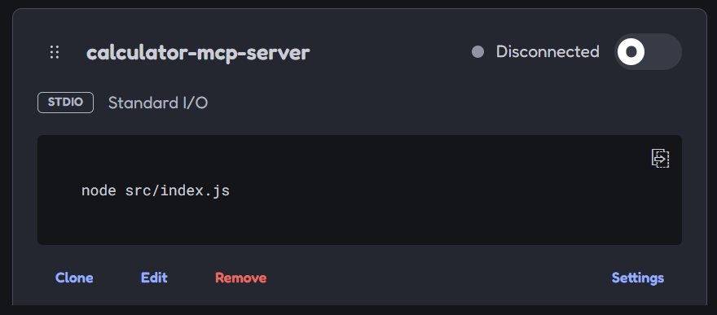

#### The Addition Tool

Inputs given to Add Tool

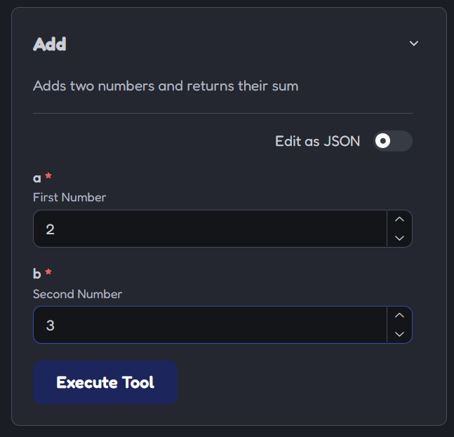

Add tool gave text and structured outputs

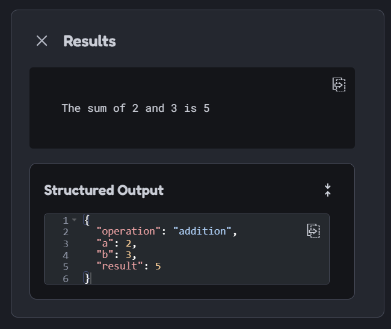

#### Subtraction Tool

Inputs given to Subtract Tool

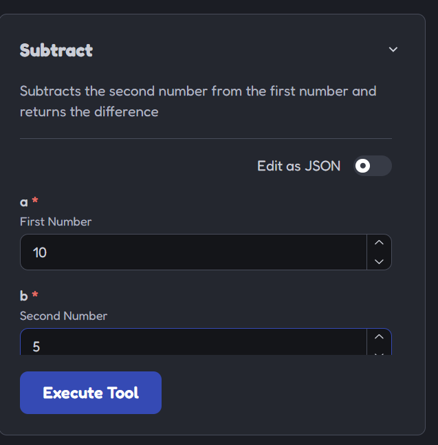

Subtract Tool gave text and structured outputs

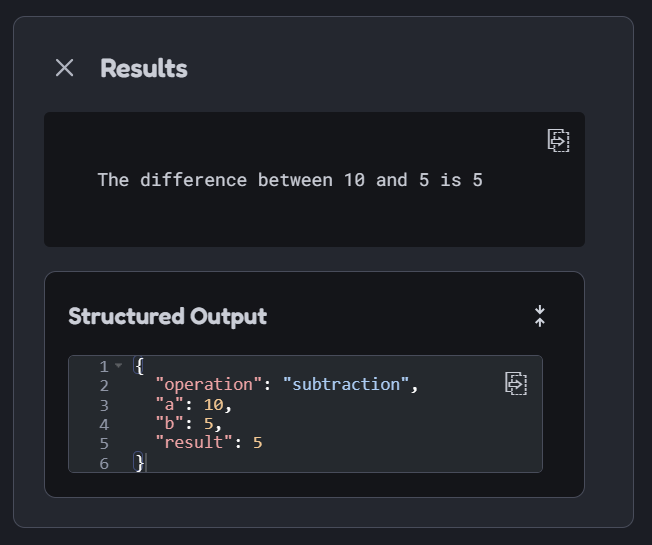

#### Multiplication Tool

Inputs given to Multiply Tool

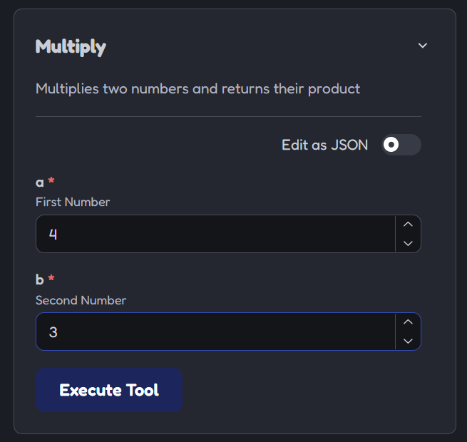

Multiply Tool gave text and structured outputs

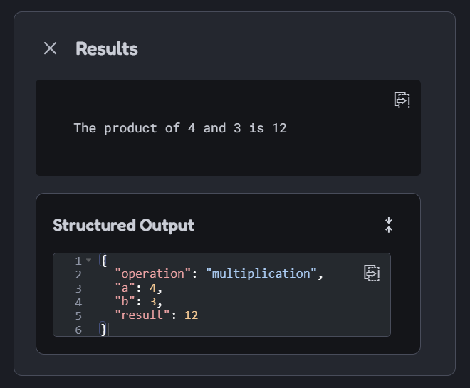

#### Division Tool

Inputs given to Divide Tool


Divide Tool gave text and structured outputs


#### Percentage Tool

Inputs given to Percentage Tool

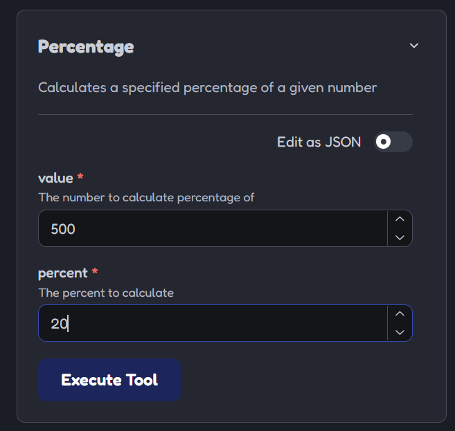

Percentage Tool gave text and structured outputs

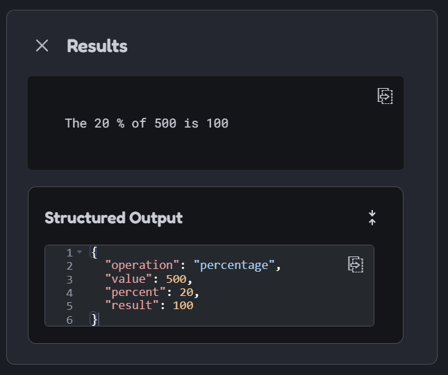

### GitHub Copilot Chat (VS Code)

Copilot was asked to find the MCP server

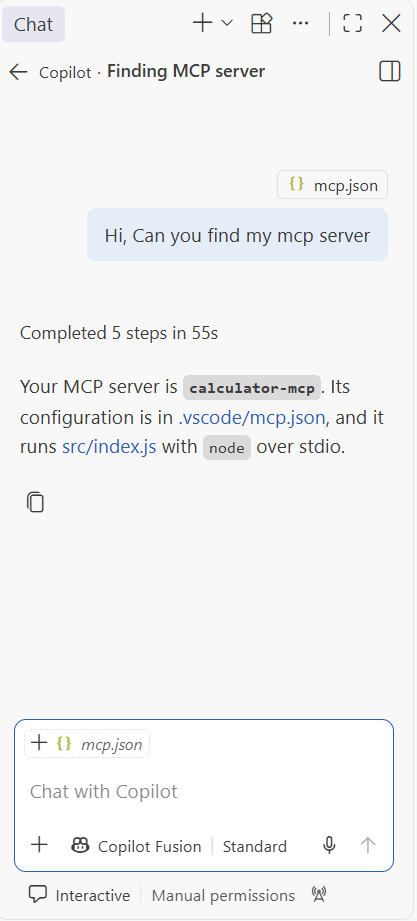

Copilot to explicitly call the addition tool to perform addition and it gave correct result

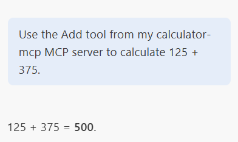

Copilot was asked to perform a calculation by using appropriate tool and it gave correct result by calling the required tool automatically

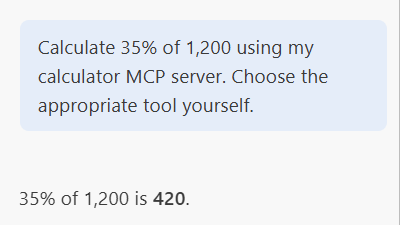

Copilot was asked to call two tools, one after the other to perform a calulation and it called the first tool, and used that result in the second calculation to giive finalresult

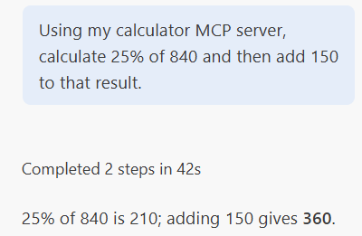

A prompt was ggiven to Copilot to perform a certain calculation that was a combinition of small calculations that were based on all five tools

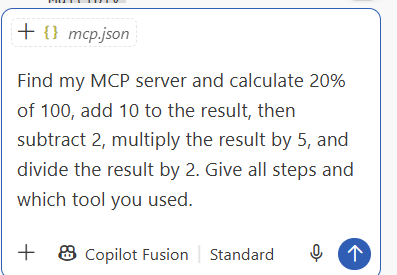

Copilot intelligently used all five tools in the same sequence of it was asked to do, it performed all and generated final result by using intermediate results of one operation as an input to subsequent operation

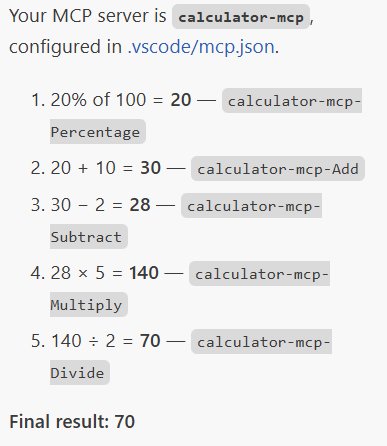

## Version

**Current published release: v1.0.0**

Structured tool outputs have been implemented and tested locally and are planned for the next release.

Future improvements may include additional calculator tools, MCP Resources, MCP Prompts, automated testing, and further error handling.

## License

This project is licensed under the ISC License. See the `LICENSE` file for details.

## Author

**Dewanshu Sharma**

GitHub: <https://github.com/sdewanshu-lab>

Project Repository: <https://github.com/sdewanshu-lab/calculator-mcp-server>